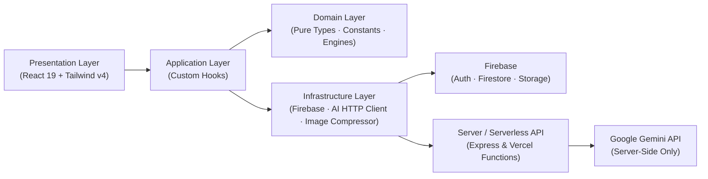

<div align="center">


# StüdyoAsistan

**Güzellik Merkezleri İçin Akıllı Operasyon, Geri Çağırma Radarı ve Instagram Bio Fiyat Hesaplayıcı Paneli**

Lazer Epilasyon · Klinik Cilt Bakımı · Protez Tırnak & Kalıcı Oje · Kaş & Kirpik

[](https://studyoasistani.vercel.app)
[](https://react.dev)
[](https://www.typescriptlang.org)
[](https://tailwindcss.com)
[](https://firebase.google.com)
[](https://ai.google.dev)

[Canlı Demo](#-canlı-demo) · [Özellikler](#-öne-çıkan-özellikler) · [Mimari](#-mimari-ve-mühendislik-prensipleri) · [Kurulum](#-hızlı-kurulum) · [Yayınlama](#-vercel-ile-yayınlama)

</div>

---

## 🌐 Canlı Demo

| Ortam | Adres | Durum |
| :--- | :--- | :--- |
| **Canlı Uygulama (Web & Mobil)** | **[https://studyoasistani.vercel.app](https://studyoasistani.vercel.app)** | Yayına Hazır |
| **Sağlık Kontrolü (API)** | `GET /api/health` | Sunucu Taraflı |

> [!TIP]
> Demo linkini kendi Vercel dağıtım alan adınızla (`studyoasistani.vercel.app` yerine kendi domain'inizle) güncellemeniz yeterlidir. Uygulama ilk girişte hesabınıza otomatik olarak gerçekçi Türkçe örnek güzellik merkezi verisi yükler; dilediğiniz an **Ayarlar → Danışanları Temizle** seçeneğiyle boş merkeze geçebilirsiniz.

<!-- Ekran görüntüleri hazır olduğunda aşağıdaki bloğu aktif edebilirsiniz:
<div align="center">
  
</div>
-->

---

## ✨ Öne Çıkan Özellikler

### 1. Bugün Özeti & Geri Çağırma Radarı (Recall Radar)
- **Otomatik Bakım Döngüsü Takibi:** Protez tırnak (`21 gün`), cilt bakımı (`30 gün`), lazer epilasyon (`35–42 gün`) ve kirpik/kaş (`45 gün`) döngülerine göre gecikmiş, bugün zamanı gelen ve bu hafta yaklaşan danışanları deterministik olarak sıralar.
- **Gelmeme (No-Show) Önleme Listesi:** Yarınki randevuları teyit durumuna (`Teyit Bekliyor`, `Onaylandı`, `İptal / Ertelendi`) göre tek dokunuşla yönetir.
- **Tek Tıkla WhatsApp & AI Üslup Cilalama:** Zero-API `wa.me` derin bağlantıları ile anında hatırlatma gönderir; isteğe bağlı sunucu taraflı Gemini AI ile samimi veya kurumsal Türkçe mesaj taslakları üretir.

### 2. İnteraktif Haftalık & Günlük Randevu Takvimi
- **Sürükle-Bırak (Drag & Drop):** Randevuları haftalık sütunlar arasında veya günlük saat dilimlerine sürükleyerek anında yeniden planlayın.
- **Mobil Dokunmatik Düzenleme:** Küçük ekranlarda yatay kaydırmalı (snap-scroll) haftalık görünüm ve tek dokunuşlu hızlı gün/saat kısayollarıyla hızlı düzenleme.
- **Hizmet Odaklı Filtreleme:** Lazer, Cilt Bakımı, Tırnak ve Kaş/Kirpik operasyonlarını anlık sayaçlarla izole edin.

### 3. AI Destekli Hızlı İşlem Kaydı & Akıllı Etiketleme
- **Serbest Türkçe Not Ayrıştırma:** Uzmanın yazdığı serbest metni (cihaz, Joule enerjisi, bölge, cilt tipi, oje renk kodu, tırnak formu, sonraki hatırlatma günü) kontrollü onay adımına (Human-in-the-Loop) dönüştürür.
- **%100 Deterministik Otomatik Etiketleme:** Yüksek enerji (`≥ 16 J`), alerji/HEMA-free protokolleri, kontrendikasyon ifadeleri ve özel müşteri isteklerini Türkçe olumsuzlama (*"kızarıklık yok"*) farkındalığıyla otomatik sınıflandırır.
- **Kesintisiz Manuel Çalışma:** API anahtarı olmadan da manuel form ve akıllı kayıt filtresi eksiksiz çalışır.

### 4. Danışan Kartları, Paket Sayaçları & Öncesi/Sonrası Arşivi
- **Aktif Paket & Ödeme Takibi:** Tamamlanan/kalan seans ilerleme çubuğu, tek tıkla `+1 Seans Düş` ve ödeme durumu (`Ödendi`, `Kısmi Ödeme`, `Seans Başı`) yönetimi.
- **Öncesi / Sonrası Karşılaştırma Kaydırıcısı:** Dokunmatik ve klavye erişilebilir kaydırıcı ile görsel sonuç takibi.
- **Bellek Dostu Görsel Optimizasyonu:** Fotoğraflar tarayıcıda `createImageBitmap` + Canvas sıkıştırmasıyla optimize edilip paralel olarak Firebase Storage'a yüklenir.

### 5. Instagram Bio Fiyat & Randevu Hesaplayıcı
- **Canlı Mobil Simülasyon:** Danışanların birden fazla işlemi seçerek tahmini toplam tutar ve süreyi anında görüp hazır WhatsApp randevu talebi oluşturmasını sağlar.
- **Tam Ekran Müşteri Modu:** Tek tıkla resepsiyonda veya bağlantıda paylaşılabilir önizleme.

### 6. Deterministik Bakım Kartları & Güvenlik Kontrolü
- **Sıfır Tıbbi Halüsinasyon:** İşlem sonrası bakım kartları (Lazer, Hydrafacial, Protez Tırnak, Kirpik/Kaş) ve işlem öncesi kontrendikasyon kontrol listesi tamamen statik, onaylı şablonlardan üretilir; PDF yazdırma ve WhatsApp paylaşımını destekler.

---

## 🏗 Mimari ve Mühendislik Prensipleri

Kod tabanı **Clean Architecture**, **SOLID**, **DRY** ve **KISS** prensipleriyle katmanlandırılmıştır:



### Klasör Yapısı

```text
studyoasistani/
├── api/ai/                       # Vercel Serverless HTTP adaptörleri (ince katman)
├── server/                       # Paylaşımlı sunucu çekirdeği (DRY)
│   ├── ai/                       # Gemini istemcisi, seans ayrıştırıcı, mesaj cilalayıcı
│   ├── config/                   # .env.local -> .env ortam yükleyici
│   └── http/                     # Güvenlik başlıkları, hız sınırlayıcı, gövde doğrulama
├── src/
│   ├── domain/                   # Çerçeveden bağımsız saf iş mantığı
│   │   ├── constants/            # Merkezi etiketler & deterministik bakım şablonları
│   │   ├── data/                 # Örnek merkez veri üreteci
│   │   ├── engines/              # dateUtils, formatters, recallEngine, timelineEngine, sessionTagEngine
│   │   └── types/                # Domain modelleri ve DTO sözleşmeleri
│   ├── infrastructure/           # Dış servis adaptörleri
│   │   ├── api/                  # AbortSignal & timeout destekli AI istemcisi
│   │   ├── firebase/             # Yalnızca .env tabanlı istemci, mapper'lar ve chunked-batch repo
│   │   └── media/                # Bellek korumalı Canvas/Bitmap JPEG sıkıştırıcı
│   ├── application/hooks/        # useAuthSession, useStudioWorkspace, useCopyFeedback, useTransientNotice
│   └── presentation/components/  # Modüler, duyarlı (Web + Mobil) arayüz bileşenleri
├── public/                       # Statik favicon ve demo görselleri
├── docs/                         # Firestore şeması ve güvenlik spesifikasyonu
├── tests/                        # Domain, güvenlik kuralları ve sunucu birim testleri
├── firestore.rules               # Varsayılan-red (default-deny) çok katmanlı Firestore kuralları
├── storage.rules                 # Sahip izolasyonlu, 5 MB & image/* sınırlı Storage kuralları
└── vercel.json                   # SPA yönlendirme ve HTTP güvenlik başlıkları
```

### Performans, Bellek, Güvenlik ve Duyarlı Tasarım Standartları

| Alan | Uygulanan Optimizasyonlar |
| :--- | :--- |
| **Performans & Bellek** | `React.lazy` ile rota bazlı kod bölme (`manualChunks` ile React/Firebase/Icons ayrımı), önbellekli `Intl.NumberFormat`, `createImageBitmap` + anında `bitmap.close()` & Canvas sıfırlama ile mobil RAM koruması, `AbortController` ile iptal edilebilir AI çağrıları, unmount temizlikli zamanlayıcı hook'ları, 400'lü paketler halinde Firestore toplu yazma. |
| **Güvenlik** | Yalnızca sunucu tarafında tutulan `GEMINI_API_KEY` (asla `VITE_` öneki yok), prompt izolasyonu (`systemInstruction`), kayan pencereli hız sınırlayıcı (rate limiter), 64 KB gövde sınırı, HTTP güvenlik başlıkları (`nosniff`, `DENY`, `Permissions-Policy`), tek kiracılı (single-tenant) doğrulanmış e-posta Firestore & Storage kuralları, güvenli görsel URL doğrulaması (`https://` / `/images/`). |
| **Web & Mobil Duyarlılık** | `100dvh` dinamik görünüm yüksekliği, çentikli telefonlar için `viewport-fit=cover` ve `env(safe-area-inset-*)` alt menü/FAB boşlukları, iOS Safari otomatik yakınlaştırmasını önleyen `16px` mobil girdi boyutu, mobilde yatay snap-scroll haftalık takvim ve kart tabanlı hizmet kataloğu, dokunmatik `touch-pan-y` Öncesi/Sonrası kaydırıcısı. |

---

## 🛠 Teknoloji Yığını

- **Arayüz:** React 19, TypeScript 5 (`strict: true`), Tailwind CSS v4, Lucide Icons
- **Derleyici & Sunucu:** Vite 8, Express 4, TSX, Vercel Serverless Functions
- **Bulut & Kimlik Doğrulama:** Firebase Authentication (E-posta Doğrulama + Google), Cloud Firestore, Firebase Storage
- **Yapay Zeka:** `@google/genai` (Sunucu taraflı yapılandırılmış JSON şeması & metin iyileştirme)
- **Test & Kalite:** Node Test Runner (`tsx --test`), TypeScript Strict Check, Firebase Security Rules ESLint Plugin

---

## 🚀 Hızlı Kurulum

### Gereksinimler
- **Node.js** `>= 20.0.0`
- Bir **Firebase** projesi (Authentication, Cloud Firestore ve Storage etkin)
- *(Opsiyonel)* AI özellikleri için bir **Google Gemini API** anahtarı

### 1. Depoyu Klonlayın ve Bağımlılıkları Kurun

```bash
git clone https://github.com/<kullanici-adiniz>/studyoasistani.git
cd studyoasistani
npm install
```

### 2. Ortam Değişkenlerini (`.env.local`) Yapılandırın

Şablon dosyasını kopyalayın ve kendi anahtarlarınızı ekleyin:

```bash
cp .env.example .env.local
```

`.env.local` içeriği:

```env
# Sunucu taraflı Gemini AI anahtarı (asla VITE_ öneki eklemeyin)
GEMINI_API_KEY="your_gemini_api_key"
# Opsiyonel model seçimi (varsayılan: gemini-4-hydrogen)
# GEMINI_MODEL="gemini-4-hydrogen"
APP_URL="http://localhost:3000"

# Firebase Web Uygulaması Yapılandırması
VITE_FIREBASE_API_KEY="your_firebase_api_key"
VITE_FIREBASE_AUTH_DOMAIN="your-project.firebaseapp.com"
VITE_FIREBASE_PROJECT_ID="your-project-id"
VITE_FIREBASE_STORAGE_BUCKET="your-project.firebasestorage.app"
VITE_FIREBASE_MESSAGING_SENDER_ID="your_sender_id"
VITE_FIREBASE_APP_ID="your_app_id"
# Opsiyonel (varsayılan "(default)" veritabanı için boş bırakın)
VITE_FIREBASE_DATABASE_ID=""
```

### 3. Firebase Güvenlik Kurallarını Yayınlayın

Firebase Console veya Firebase CLI üzerinden proje kökündeki şu iki kural dosyasını etkinleştirin:
- [`firestore.rules`](./firestore.rules) (Veri şeması ve güvenlik spesifikasyonu: [`docs/firestore-schema.json`](./docs/firestore-schema.json), [`docs/security-spec.md`](./docs/security-spec.md))
- [`storage.rules`](./storage.rules)

### 4. Geliştirme Sunucusunu Başlatın

```bash
npm run dev
```

Uygulama varsayılan olarak **[http://localhost:3000](http://localhost:3000)** adresinde çalışacaktır.

---

## ☁️ Vercel ile Yayınlama

Proje [`vercel.json`](./vercel.json) ve [`api/ai/`](./api/ai) serverless uç noktalarıyla Vercel'e doğrudan dağıtım için hazırdır:

1. GitHub deponuzu **Vercel**'e bağlayın.
2. **Project Settings → Environment Variables** bölümüne `.env.example` içindeki tüm değişkenleri ekleyin (`GEMINI_API_KEY` değerine kesinlikle `VITE_` öneki eklemeyin).
3. **Firebase Console → Authentication → Settings → Authorized domains** listesine Vercel alan adınızı ekleyin.
4. **Deploy** butonuna tıklayın — `npm run build` ve `/api/ai/*` fonksiyonları otomatik olarak yayınlanır.

---

## 🧪 Komutlar ve Testler

| Komut | Açıklama |
| :--- | :--- |
| `npm run dev` | Express + Vite HMR geliştirme sunucusunu başlatır (`.env.local` destekli) |
| `npm run build` | Üretim (production) frontend paketini `dist/` içine derler |
| `npm run start` | Derlenmiş üretim uygulamasını Express üzerinden sunar |
| `npm run typecheck` | Tüm istemci, sunucu ve test dosyalarında `tsc --noEmit` çalıştırır |
| `npm test` | Domain motorları, güvenlik kuralları ve sunucu doğrulama testlerini çalıştırır |
| `npm run lint` | Firebase güvenlik kuralları ESLint denetimini çalıştırır |
| `npm run verify` | `typecheck` + `test` + `build` aşamalarını tek seferde doğrular |

---

## 📄 Lisans

Bu proje özel veya açık kaynak lisans tercihinize göre yapılandırılmaya hazırdır. Ticari veya kişisel kullanım öncesinde kendi `LICENSE` dosyanızı ekleyebilirsiniz.
